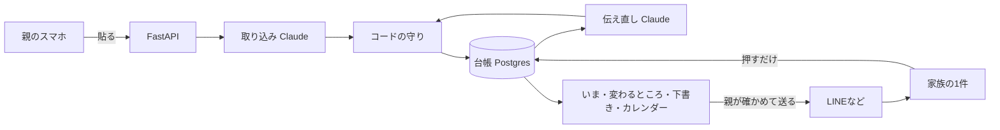

# アンサンブル — 付き添い入院の負担軽減AI

**突然の子どもの入院でも、家庭ごとに違う調整を、ひとりに背負わせない。**
Every family's hospital stay is different. No parent should have to carry the coordination alone.

カレンダーは日付を1つしか持てない。付き添い入院の予定は、条件つきの、いくつもの未来。

- 医師に言われたことや届いたLINEを貼ると、Claudeが、誰の用件か・確かか見込みか・条件は何かを台帳に分けます。
- 退院の見込みが変わったら、病院・職場・保育園・預け先・家族それぞれへの伝え直しと、前の確認を取り消す連絡が並びます。親は確かめて、送るだけです。
- 動くのは周りの人です。夫はアプリを入れなくても、届いたリンクから押すだけで返事できます。

試せるURL：<https://ensemble-8fmu.onrender.com>（試作。実在の人の名前や病名は入れないでください）

## 誰の、どんな課題か
子どもが入院すると、親が病室に泊まり込み、24時間世話をします。経験者調査の回答者の75.0%が、病院から付き添いを求められました（付き添い白書2025）。

病室を離れられない親が、病院・職場・保育園・家族への連絡を、ひとりで回します。退院日は「検査の結果しだい」で何度も変わり、そのたびに組み直します。

作り手は付き添い入院を3回経験しました。1回目は面会制限で、病室に泊まれる人がほかにいませんでした。家庭Bの「ほかに泊まれる人がいない」という条件は、この経験から置いています（ほかの設定は合成です）。3回目でも30分刻みの週間表を手で作り、退院日が変わるたびに作り直しました。1回目から3回目で身についたこと（持ち物は初日にまとめて頼む、仕事は病室から出られるかで分ける、具体的な物と場所で頼む、退院日は候補のまま仮押さえする）は、次の家族には渡りません。アンサンブルは、その経験を仕組みにしたものです。

## 線引き
- 医療の判断も、心のケアもしません。判断を求める問いには、内容によらず同じ固定文を返します。止めるのはプロンプトではなくコードです。
- 公開物に使うのは合成データだけです。
- 家族の連絡と調整を整理するための試作です。診断・治療・予後の判断を目的とせず、医療機器ではありません（該当性は確認中）。

## 効くもの、効かないもの
**効かないもの**
- 体調の悪い子を24時間ひとりで世話すること。これがいちばんの消耗で、アプリでは軽くなりません。
- 子の様子（食べたか、熱、機嫌）を夫に伝えること。夫の「どうだった？」の一部は、このボードでは減りません。
- 付き添う親の食事と寝床。一言を残せるだけで、良くはなりません（次の版で、同意した家族の分を件数で束ね、声にする設計です）。
- 子の食事と服薬、付き添う人の睡眠と体調、気持ち。

**効くもの**
- 医師の言葉を家族へそのまま伝えること（原文で残ります）。
- 退院の見込みが変わるたびの、相手ごとの連絡のやり直し（相手に合わせた文が並びます）。
- 誰に何を頼んで、何を待っているかが見えること（相手別と進捗別）。

## できること
| 画面 | 内容 |
|---|---|
| いま | 次にできることを1つと、主なボタン1つ。届いた返事（夫のひとことを含む）と、医師の言葉の節・候補日（見込み／取り消し／検査の札）。医療の問いには固定文を先に出す |
| 入れる | 聞いたこと・頼みたいことを打つか貼る。誰から・何をしたいかを選べる。これまでに入れたものを3件出す |
| 説明を聞いたあと | 医師の言葉の分かれ道から、聞いた結果を選ぶ。入る文は節からの決まった言い換えだけで、押した直後に［元に戻す］ |
| 変わるところ | 根拠の言葉、退院候補（医師の言葉から）、8日の帯、相手ごとに変わるところを線で見せる。押すまで台帳は変わらない |
| 下書き | 相手ごとのタブで文を確かめて直し、親がコピーかLINEで送る。送ったら［伝えた］ |
| やりとり・進み具合 | 相手ごとの行と、段（別の手を決める／保留の返事／これから／返事待ち など）、相手別の表。丸を押すと済。開くと文の直しと履歴 |
| 家族の1件 | アプリなしで開ける。3択（持っていく／時間を相談したい／今日はむずかしい）と、ひとこと40字まで。親の「いま」のカードに戻る。親の下書きは読むだけ |
| カレンダー | 候補日・検査・用事の日。案から作った連絡は、医師の言葉の同じ曜日の日に置く |
| しおりから探す | 資料の写真は端末の中だけに保存。問いには資料の文そのままと、種類・撮った日で答える。医療の問いには固定文だけ |
| 自分のこと | 親自身の食事・睡眠・体調を文で一言。新しい順に日時つきで残る。AIへ送らず、数値も催促もない |
| 自分の家庭（試作） | 選ぶ形の設定だけで始める。自由な文字は入れない。メニューの「この記録を消す」で消せる |
| ゴミ箱 | 消す前に確認し、消したものは後から戻せる |

**病室に泊まれる人がほかにいない家庭でも閉じます。** 家庭Bでは、夫に平日夕方の迎えを頼まず、保育園の延長（最長18:30）とファミサポに分けて空きを聞きます。保育園が「18:30まで可」と答えても、その後の迎えは返事待ちのまま残ります。

仕事の変更管理と起票の考え方を借りました。違いは3つです。期日が条件つきでいくつもあること。決めるのが親であること。医療のことは起票せず、固定の文を返すこと。ガント、工数、優先度、期日の催促、担当の自動割り当て、コメントのやりとりは入れていません。

## 評価（実測）
合成データで、本物のClaudeを当てて測りました。この試験の範囲での結果です。2026-11-06 の行は、公開中の版（da3ece2）で測り直した値です。2026-11-03 の行は測り直していません。

| 何を | 結果 | 測った日 |
|---|---|---|
| 医療の判断の漏れ（判断を求める問い15件＋急な症状5件） | 0/20 | 2026-11-06 |
| 生活の用事を医療の問いとして誤って止めた | 0/12 | 2026-11-06 |
| しおりの検索欄の道の医療の漏れ（判断を求める問い25件＋急な症状5件） | 0/30。判断を求める問いのうち11件は入口の語の守りが止め、AIまで届いた14件は 14/14 | 2026-11-06 |
| しおりの検索欄の道で、生活の問いを誤って止めた | 1/16（「腫れはひいてきました」を症状の語で止めた。止める側への誤り） | 2026-11-06 |
| 根拠IDの不一致（本物の案のすべて） | 0/131 | 2026-11-06 |
| 日付の作り込み（本物の下書きのすべて） | 1/122（守りの誤検知。「、日ごとに」を日曜と読んだ。呼び直しで通り、画面に出たのは0） | 2026-11-06 |
| 伝え直しの中身が台本の案を満たす（4件×3回） | 12/12 | 2026-11-06 |
| 説明を聞いたあとの結果と親の選択から、案が出る（4件×3回） | 12/12 | 2026-11-06 |
| 自分の家庭（頼める人がいる／いない）で、案が条件を満たす（4件×2回） | 8/8 | 2026-11-06 |
| 案の分かれ道に、次の段（検査の日と退院候補）が出た | 42/42 | 2026-11-06 |
| 家庭A・家庭Bで、貼るから案を進めるまで通す | 2/2 | 2026-11-06 |
| 撮影の順に、貼るから夫の答えが戻るまで通す | 1/1 | 2026-11-06 |
| 家庭Bの場面（夫に頼めない迎えを、保育園と支援に分ける） | 1/1 | 2026-11-06 |
| 自分の家庭で、取り込みから案を進めるまで通す | 4/4 | 2026-11-06 |
| 取り込みの仕分け | 9/10（1件は「行動」と「予定」の分け方の揺れ。期待値は変えていません） | 2026-11-03 |
| 医師の言葉と結果の書き方を変えても案が出る | 12/12 | 2026-11-03 |

画面は偽のAIで検査しています。明るい画面と暗い画面を、横スクロール、押せる高さ48px、間隔8px、文字14px以上、コントラスト4.5、主なボタンの位置の6つの基準で測ります。開く曜日を変えた日付の読み方と、撮影の日付の画面も含めて約13,300件で、不合格は0です。本文の文字は15pxです。

結果の原文は [evals/](evals/) にあります。通しの流れ（各1回）は、結果を [docs/devlog/2026-11-06.md](docs/devlog/2026-11-06.md) に書いています。原文のファイルはありません。数え方は [scripts/eval_numbers.py](scripts/eval_numbers.py) です。

## Claudeの使い方
**製品の中**：呼び出しは4つです。

| 呼び出し | 役割 | effort |
|---|---|---|
| 取り込み | 貼った文を、相手・種類・確かさ・条件のついた項目に分ける | medium |
| 伝え直し | 分かれ道と、相手ごとの文、根拠ID、取り消す連絡を作る | high |
| 読み取り | 資料の写真を文にする。検査結果は断る | medium |
| 探す | 質問に、資料にある文を引用で返す。引用は資料と照合する | medium |

- **AIの出力は、画面に出す前に全部コードで検査します。** 根拠IDの実在、原文に無い日付、医療の語、見込みを確定にしないこと。違反は理由を添えて1回だけ呼び直し、2回目も落ちたら「案を出せませんでした」と出します。
- 下書きの医療の語は、医師の説明の原文にある語だけ通します。職場・保育園・支援への文には通しません。
- 職場への文は、候補日と条件で書き、出られない予定を名指しして代役か延期かは相手に委ね、病名と制度名を書きません。作り手の経験から入れた決まりです。
- 伝え直しには、家の事情（設定）、台帳、今日の日付、これまでの案の経緯、親が選んだ分かれ道を渡します。経緯は誰が・いつ・どの状態にしたかだけで、文は渡しません。
- 案の引用の欄（医師の言葉の節、次の段の日、頼みごとの文）は原文と照合し、確かめられないものは捨てます。候補日と次の段の日は、同じ節の原文にある曜日だけを通します。
- 親の一言はAIへ渡しません。夫や職場への文に混ざらないようにするためです。
- 親が直した文には、日付の守りを当てません（AIの作った日付を止めるものなので）。医療の語だけ当てます。
- モデルは4つとも `claude-opus-5-5` で、プロンプトキャッシュは使っていません。6日の開発で、モデルの比較より文の質と守りの通過率を優先しました。1回の費用の見積もりは、取り込みが約$0.02、伝え直しが約$0.07です。

**開発（Claude Code）**：事実だけを書きます。
- `CLAUDE.md` を、崩さないことと守りの関数を書いた契約にしました。平日の日中はこの約束の範囲で進め、商品の判断は `QUESTIONS.md` に書いて止まらずに次へ進みました。
- 作る人と見る人を分けました。計画、開発、レビューを別のセッションにし、計画は10往復のレビューを受けてから実装に入りました。第三者レビューは審査基準で読ませ、見つかった穴（医療語の守りが実質効いていなかった、など）を直してから数字を測り直しています。
- サブエージェント（critic）で追加の機能を精査し、5件を3件に減らしました。フックで、秘密情報の混入をコミットとpushの前に止めています。
- 本物のAIは評価のときだけ呼び、画面の検査は偽のAIで回して費用を抑えました。判断の理由は [decisions.md](decisions.md) に、試行錯誤は [docs/devlog/](docs/devlog/) に残しています。

## 構成

画面は Vite + React で、同じサーバーから配ります。家族コードはURLの `#` より後ろに置くので、サーバーの記録に残りません。写真は端末の中（IndexedDB）にだけ保存します。

**台帳のスキーマ**（契約。土台の版で、案の引用の欄と家族設定の欄を足しました）
```
family: code, version, profile（configured, choices を含む）, aliases, rules
items[]: id, kind, part, text_original, task_summary, speaker, recorded_at,
         certainty, condition, medical, refers_to, status, owner, due, location
branches[]: id, condition_item_id, candidate_days[],
            outcomes[]: label, clause, clause_item_id, next[]（day, kind, clause）,
                        actions[]: part, type, draft, basis_ids[], release[], ask
```
`candidate_days` は取り消した日も残します。`certainty` と `condition` があるので、「木曜に帰れるかも」を確定の予定にせず、見込みのまま扱えます。

**作り手のルール**（手作りの表から）
1. 会議を「話す／聞くだけ／動かせる」に分ける：今回は機能にしません。
2. 退院の候補日ごとに、預け先を仮押さえする。決まったら、ほかの日を外す：使います。
3. 子の世話の時刻と、病室に入る人の時刻を合わせる：病室に誰がいるかを描かないと決めたので使いません。
4. 二人が同時に病室を離れない：同じ理由で使いません。
5. 延びたら作り直し、前の週は残す：使います。

## 動かし方
```
python -m venv .venv && .venv/Scripts/python -m pip install -r requirements-dev.txt
cd frontend && npm install && npm run build && cd ..
.venv/Scripts/python -m pytest -q
.venv/Scripts/python -m uvicorn ensemble.main:app --app-dir backend --port 8000
```
`.env` に `ANTHROPIC_API_KEY` を入れます（`env.example` を参照）。DBは `DATABASE_URL` が無ければ手元の SQLite です。

## この先
- 自分の家庭の道は試作です。選ぶ形の設定だけで、実在の人の名前や病名は入れないでください。メニューの「この記録を消す」で消せます。
- 夫への通知。今は親がLINEで送る形です。
- 子の様子（夫の「どうだった？」に返していたこと）、夫が病室に来る時刻。
- 同意を得た記録を件数で束ね、NPOを通じて病院と制度を変える材料にする層（設計のみ。今回は作っていません）。
- 実運用の個人情報と医療機器の該当性の確認、配る経路（未合意）。
- 広がり：親の介護、医療的ケア児の在宅ケア。既存の支援職の仕事を置き換えるものではなく、家族に残る日々の調整を支えます。

挿絵は画像生成で作成します。

## ライセンス
MIT
