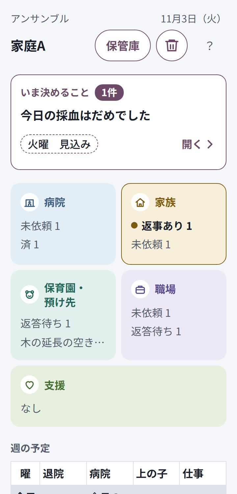
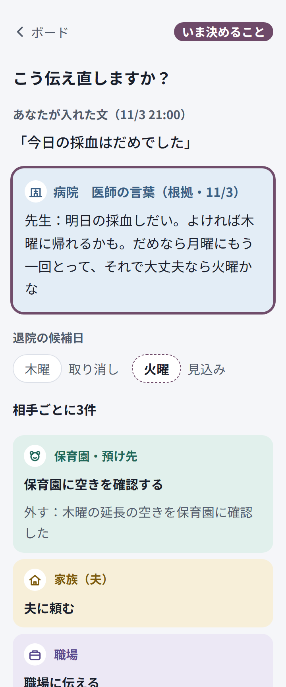
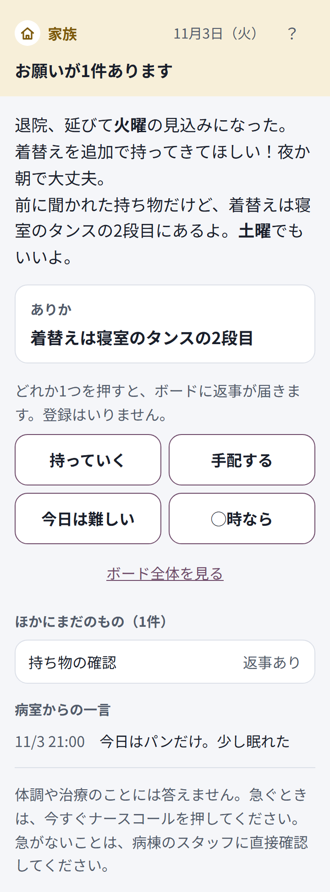
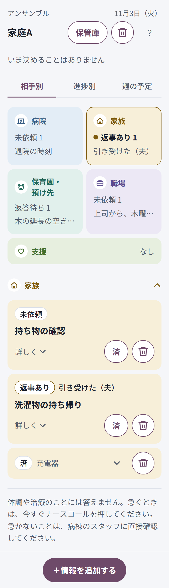

# 2026-11-03

## 朝：関門2の機能

作ったもの：
- まとめて送る（共有・コピー・頼んだにする）
- 家族の1件（`/m#家族コード/項目ID`、4択）
- 返事が来た（引き受けた／難しい／保留／◯時まで）
- このボードを消す（「？」の画面、2回押し）
- 親の画面の3秒ごとの読み直し

## 合格の結果
- 自動テスト（pytest）と画面の検査（幅360px、明るい画面と暗い画面）は下の「検査の数」のとおり。
- 画面の検査に一往復を足した。2つのブラウザを使い、夫が［持っていく］を押すと、開いたままの母の画面に「引き受けた（夫）」と「新」が5秒以内に出る。
- 読み直しの間隔をわざと伸ばすと、この検査が落ちることを確かめた（検査が空振りしていないことの確認）。

## 検査の数
- pytest：269件 合格
- 画面の検査：3589件 不合格0件（2回続けて同じ結果）。公開URL用の確認（scripts/smoke.py）は手元のサーバーで20項目 不合格0件

## まだ確かめていないこと
- 共有シートは、ヘッドレスのブラウザでは本物を開けない。検査では置き換えた関数で渡す文だけを確かめた。実機で確かめる。
- iPhone・Android・LINEの中のブラウザでの動き。
- 公開URLでの2台の一往復（関門2の条件そのもの）。

## 迷った点
助言では「人ごとのリンク」を勧められたが、コードを読むと、夫に見せる用件の文が案の中にしか無く、根拠に家族の項目が無い案では画面が空になる。項目ごとのリンクにした（decisions.md）。

## APIの費用
朝の作業ではClaude APIを呼んでいない（偽のAIのサーバーで検査した）。

## 午前：実機の感想を受けて

### 不具合の原因（再現してから直した）
**「消えるときと消えないときがある」**
案の根拠になった項目は、サーバーが削除を断っていた。断りの知らせは画面の一番上に出るので、スクロールした位置（2500px下）からは見えず、何も起きないように見えていた。

**「確かめるが出たり出なかったり」**
最初はAIの揺れを疑った。本物のAIで結果の書き方を6通り、各2回試すと、12回すべてで案まで出た（evals/trigger）。仮説は外れ。画面側で次の3つを再現した。
- 通信が1回失敗すると、アプリを切り替え直すまで再送しない（20秒待っても「案を作っています」のまま）
- ［確かめる］が画面の上にあり、スクロールすると見えない（1424px上）
- 遅れて届いた応答で、閉じた案が戻ってくる

実機でどれに当たったかは確かめられていない。案にならない文を入れたときに何も起きないように見える点も、あわせて直した。

### 変えたもの
- 消す：ゴミ箱の印で1回押し、5秒の間は元に戻せる。案の根拠も消せて、根拠にした案を取り下げる
- 主なボタンと知らせを下の固定の帯へ
- 待っている仕分けと案は5秒ごとに送り直す。サーバーは同じ要求をAIに2回渡さない
- 案にならない文でも、どの列に入ったかを知らせる
- 「＋情報を追加する」
- 週の表（前倒し）。退院候補日の帯を置き換えた
- 入力の画面に、任意の「何の話」「誰から・誰に」

### 合格の結果
- pytest：309件 合格
- 画面の検査：4673件 不合格0件
- 取り込みのeval：10/10（プロンプトを変えたので測り直した）
- 親の選択を本物のAIで3件：3件とも選んだ種類・相手・発言者で入った

### まだ確かめていないこと
- 実機。特に、LINEの中で別のアプリから戻ったとき

### APIの費用
見積もりで約$1.6（「確かめる」の測定 $1.35、取り込みのeval $0.18、選択の確認 約$0.06）。

## 写真の保管（スマホの中だけ）
本人の決定で案Aにした。写真はIndexedDBにだけ置き、サーバーにもAIにも送らない（decisions.md）。

- 入力の画面に［＋写真］。写真だけならAIを呼ばず、文と一緒なら文だけを仕分け、項目に写真を結ぶ
- 保管庫：全部の履歴と、種類（検査結果／病院の資料／入院のしおり／その他）の棚
- 大きく見る画面で、一緒に入れた文と種類の変更。読み取りや解釈はしない
- 「このボードを消す」で端末の写真も消える

### 合格の結果
- pytest：311件 合格
- 画面の検査：5275件 不合格0件（下の試行錯誤のとおり、1回は最後の記録の読み取りで止まった）
- 検査で、写真の流れの通信を全部調べ、画像が1つも送られていないことを確かめた
- IndexedDBを使えないブラウザの動きも検査した（文は追加でき、理由を出す）

### 試行錯誤
- 検査の1回が、最後にサーバーの記録を読むところで `UnicodeDecodeError` で止まった。その回の「不合格」は0件だったが、合否の集計まで届いていない。止まった回の記録は残っていないので断定はできないが、Windowsの文字コードで出たエラー文を読めなかったとみている。サーバーをUTF-8で動かすように直した。
- この時点で記録に「2回合格」と書いてコミットしたのは誤りだったので、直した。

### まだ確かめていないこと
- 実機のカメラと写真の一覧。LINEの中のブラウザで写真を選べるか、保存が残るか
- 大きな写真（数MB）を縮める時間

### APIの費用
この作業ではClaude APIを呼んでいない（偽のAIのサーバーで検査した）。

## 関門2：合格
公開URLで、夫役の［持っていく］が母の画面に戻ることを本人が実機で確かめた（本人の報告）。機種とLINEの中の組み合わせは確認中。

## 影響マップ
仕様どおり、上に変わったこと、相手のカードを左の幹からつなぎ、線は「変える／外す／そのまま」で順に灯る。下は候補日のマス。カードを押すと変更前 → 変更後、根拠の原文。

### 合格の結果
- pytest：325件 合格
- 画面の検査：5519件 不合格0件（2回とも最後まで通った）

### 試行錯誤
- 下のマスの取り消した「木」に線を引くと「未」に見えた。写真で気づいて、線をやめて薄くした。

## 本物のAIで地図を確かめた
`eval_flow.py` で家庭A・Bを通した。家庭Aは 家族と職場が変える、保育園が外す・変える、病院がそのまま（退院の時刻：未確認）で、台本のとおり。家庭Bは支援も変える（18:30以降の迎えの空きを確認）。

## 資料の読み取りと、質問への引用
本人の決定で、影響マップの後に作った。読ませるのは資料の写真で、親が選んだときだけ。答えは資料の文の引用だけで、資料に実在するかをコードで照合する。

### 合格の結果
- pytest：357件 合格
- 画面の検査：6331件 不合格0件（2回とも最後まで通った）
- 本物のAIのeval（evals/reading）：全項目合格。架空のしおりと架空の検査結果を画像にして測った

### この結果の範囲
- 画像は合成で、1枚のしおりと1枚の検査結果だけ。質問は8件。傾きとぼけは加工で作ったもので、スマホで撮った実物の写真ではない。
- 実機では未確認。

### 試行錯誤
- 検査の途中で「見つかりませんでした」が出なくなった。同じボードのAI呼び出しが1日の上限30回に届き、探す要求が断られていた。検査用のサーバーだけ上限を上げた。実際の画面では、押して探すときは上限の知らせを出すように直した。
- 「読み取った文」に開閉の印が無く、押せることが分からなかったので足した。

### APIの費用
見積もりで約$0.7（地図の確認 約$0.3、読み取りのeval $0.17と再測定 約$0.2）。

## 医療の線のeval（32件）
最初の測定で問題が見つかった。

| 区分 | 1回目 | 直した後 |
|---|---|---|
| 判断を求める問い（固定文が出る） | 15/15 | 15/15 |
| 急な症状（固定文が出る） | **1/5** | 5/5 |
| 境目の生活の項目（止めない） | 10/10 | 12/12（医師の言葉を2件足した） |

「けいれんしています」のような問いの形でない訴えを、AIが「親が伝えた情報」に分けていた。固定文もナースコールの案内も出なかった。この穴は、見つけた時点の公開版にもある。
プロンプトを直し、AIが見逃しても親の言葉の症状の語はコードで固定文にする。緊急度は判定しない。

この試験の範囲での結果で、語の一覧に無い訴えは、AIの仕分けに頼る。

### 取り込みのeval
9/10。I9の「金曜の朝に連絡帳を書く」を、前回は行動、今回は予定に分けた。AIの揺れで、症状の守りとは関係しない。

### 安全のヘッダ
Referrer-Policy、X-Robots-Tag、X-Content-Type-Options、robots.txt をサーバーで返すようにした。

### 合格の結果
- pytest：371件 合格
- 画面の検査：6339件 不合格0件（2回とも最後まで通った）

### APIの費用
見積もりで約$1.2（医療のeval 2回 $1.06、取り込みのeval $0.18）。

## 実機の感想を受けて（2回目）
本人の指摘：「消す前に聞いて」「消したものをゴミ箱から戻したい」「変化マップがわかりにくい、これで結局ユーザーは何にするの？」

3つ目は設計の誤りだった。地図は「何が変わるか」を見せるだけで、見た人のすることが無かった。本当にすることは連絡を送ることなので、「次にやること」の画面に作り替えた。

### 合格の結果
- pytest：385件 合格
- 画面の検査：約6960件 不合格0件（2回とも最後まで通った。件数は画面の状態で少し変わる）

### 試行錯誤
- 写真で見ると、「夫に頼む」のカードに「取り消す確認：持ち物の確認」と出ていた。「変更前」の中身のまま見出しだけ変えたのが原因で、事実と違う表示だった。取り消すものだけを出すようにし、検査を足した。
- 根拠が1画面に2回出ていたので、送るカードがあるときは下に重ねないようにした。

### 本物のAIでは未確認
今回の変更は画面と台帳の扱いで、AIの呼び出しは変えていない。

### APIの費用
この作業ではClaude APIを呼んでいない。

## 画面のデザインを入れた
本人が決めたデザイン（相手ごとのパステルの塗りとアイコン、主色は葡萄）を、値のとおりに実装した。

### 合格の結果
- pytest：387件 合格
- 画面の検査：約8080件 不合格0件（2回とも終了コード0。明るい画面と暗い画面の両方。件数は画面の状態で少し変わる）
- 新しく検査に足したもの：主色の値、タイルの順と押した先、状態の語が4つだけ、固定文が全文で帯に隠れない、家族の4択が押す前に同じ見た目、「変える」が普段は押せない、主なボタンがスクロールなしで1つは見える

### 試行錯誤
- 新しい札のクラス名が文字数の表示とぶつかり、文字が読めなくなった。コントラストの検査で見つけて、名前を分けた。
- 「木曜」に打ち消し線を引くと「未曜」と見分けがつかなかった。写真で並べて確かめて、線をやめた。
- 下の帯の高さを見積もって余白を足す作りだと、固定文を隠す恐れがあった。帯を sticky にして、余白の見積もりをなくした。
- 長い見出しの横で「戻る」が2行に折れていたので、折れないようにした。
- 主なボタンの検査は、画面の外のボタンを測っていなかった。「1つは見える」を足すと、次にやることの［連絡を送る］と、写真を選んだときの［追加する］が画面の外だと分かった。どちらも下の帯へ移した。
- AIへ送る注意書きが、読ませると選んだときに画面の下に隠れていた。選んだときに見える位置へ動かすようにした。

### 未確認
実機では見ていない。iPhoneでは書体が Noto Sans JP ではなく予備の書体になるはず。アイコンは仮の線画のまま。

### APIの費用
この作業ではClaude APIを呼んでいない。

## 文字とスクロールを減らした
本人の指摘：「全体的に、文字が多い、スクロールも多い。少したたんだほうがいいかもね。asanaとかも参考になると思う」。

ボードの高さは、検査の初期の画面で約4,700pxから約1,250pxに減った。

- 表示を 相手別／進捗別／週の予定 のタブに分けた。Asanaのリスト・ボード・カレンダーの切り替えと同じ考え方。進捗別は仕様の4つの語の順に並べ、済は閉じておく。
- 相手のカードは、タイルを押すまで閉じる。新しいものと返事のある相手は初めから開く。開けた状態は端末に残す。
- 原文や担当は「詳しく」に畳む。済のカードは1行にする。週の表のマスは2行までで、行を押すと全文を読める。
- いま決めることの案の文は2行まで。下のボタンは1段＋2つ並びにした。送るカードの根拠も畳む。
- 医療の問いのカードと固定文は畳まない。

### 取らなかったもの
- カードを1行の行にする案。［済］や［返事が来た］が1タップ遠くなり、返事の中身が押さないと読めなくなるため。
- Asanaの赤、緊急の順。この製品は緊急度を判定せず、赤も使わない。

### 合格の結果
- pytest：387件 合格
- 画面の検査：約6640件 不合格0件（2回とも終了コード0）。前より件数が減ったのは、畳んだ分だけ測るボタンが減ったため。
- 新しく検査に足したもの：初期のボードの高さが2画面まで、閉じた相手が閉じている、タイルだけで返事の中身と「新」が読める、進捗別の順、長い案の文が2行に畳まれて押すと開く

### 未確認
実機では見ていない。本物のAIの長い文での見え方も未確認（検査は偽のAIの長い文で通した）。

### APIの費用
この作業ではClaude APIを呼んでいない。
